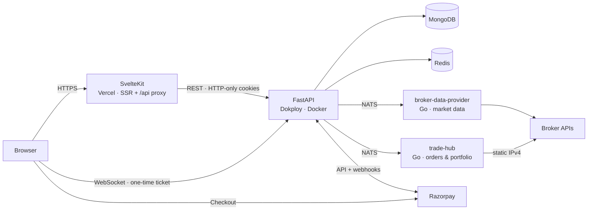

<div align="center">

# Svakosh

**Market analytics, live trading and subscriptions for Indian equities and derivatives.**

[**Live Demo**](https://svakosh.vercel.app) · [**Report an Issue**](https://github.com/Deepak-GitHub1474/svakosh/issues)

`SvelteKit` · `Svelte 5` · `TypeScript` · `Tailwind CSS v4` · `FastAPI` · `MongoDB` · `Redis` · `NATS` · `Go` · `Razorpay`

</div>

---

## Overview

Svakosh is one workspace for:

- **Analytics** — option chain, open interest, max pain, straddle/strangle, PCR, breakout screeners and market overview on live NSE/BSE data.
- **Trading** — link broker accounts, place and manage orders, track positions, holdings and funds.
- **Watchlists** — multiple lists with live prices and private notes.
- **Subscriptions** — Premium Analytics and per-broker-account plans billed through Razorpay.

The UI is built without a component library; the frontend ships three runtime dependencies (`echarts`, `tailwind-merge`, `@simplewebauthn/browser`).

---

## Architecture



### Connections

| From → To                      | Protocol          | Carries                                              | Secured by                                         |
| ------------------------------ | ----------------- | ---------------------------------------------------- | -------------------------------------------------- |
| Browser → SvelteKit            | HTTPS             | Pages, `/api/**` calls                               | HTTP-only, same-site auth cookies                  |
| SvelteKit → FastAPI            | HTTPS (REST)      | Every API call, forwarded server-side                | Access token from the cookie, refreshed on expiry  |
| Browser → FastAPI              | WebSocket         | Live ticks, order and position updates               | Short-lived, single-use ticket                     |
| FastAPI → MongoDB              | TCP               | Users, watchlists, subscriptions, payments           | App-scoped DB user on a private network            |
| FastAPI → Redis                | TCP               | Sessions, OTP, caches, job lock                      | Password, private network                          |
| FastAPI → broker-data-provider | NATS              | Quote, chain and history requests; tick stream       | Authenticated NATS user, subject permissions       |
| FastAPI → trade-hub            | NATS              | Account, order and portfolio requests; order updates | Its own NATS on the private Docker network         |
| broker-data-provider → Broker  | HTTPS / WebSocket | Market data                                          | Broker API session                                 |
| trade-hub → Broker             | HTTPS / WebSocket | Orders, positions, holdings, funds                   | Per-account broker session from a pinned static IP |
| FastAPI ↔ Razorpay             | HTTPS + webhooks  | Subscriptions, payments, renewals                    | API key; HMAC-verified signatures                  |
| Browser → Razorpay             | Checkout          | Card / UPI payment                                   | Razorpay-hosted checkout                           |

### Services

broker-data-provider and trade-hub are separate private services; Svakosh talks to them only over NATS.

| Service                            | Stack                | Runs on          | Responsibility                                                    |
| ---------------------------------- | -------------------- | ---------------- | ----------------------------------------------------------------- |
| **frontend** (this repo)           | SvelteKit, Svelte 5  | Vercel           | SSR pages and the `/api/**` proxy that holds auth cookies         |
| **backend** (this repo)            | FastAPI, Python 3.13 | Dokploy (Docker) | Auth, watchlists, analytics, trading API, billing, live WebSocket |
| **broker-data-provider** (private) | Go                   | Dokploy          | Streams quotes, option chains and history from brokers over NATS  |
| **trade-hub** (private)            | Go, MongoDB, Redis   | Dokploy          | Broker sessions, orders, positions, holdings and funds over NATS  |
| **MongoDB · Redis**                | —                    | Dokploy          | Persistent data · sessions, OTP, caches and job locks             |

### Request flows

**REST.** The browser never calls the API directly. SvelteKit routes under `frontend/src/routes/api/**` forward each request server-side with the HTTP-only auth cookies, and retry once after refreshing an expired access token. Tokens never reach client JavaScript.

**Live data.** The browser opens one WebSocket to the API with a short-lived, single-use ticket. The API fans out market ticks from broker-data-provider and order/position updates from trade-hub over that one connection.

```
Broker ─► broker-data-provider ─► NATS ─┐
                                        ├─► FastAPI ─► WebSocket ─► Browser
Broker ◄─► trade-hub ─────────── NATS ──┘
```

**Orders.** `Browser → /api/trade/* → FastAPI → NATS → trade-hub → broker`. FastAPI checks for an active Broker Account subscription on that account; trade-hub owns the broker session and sends every call from the account's pinned static IP.

**Payments.** `/pricing` asks the API for a quote, the API creates a Razorpay subscription, and the browser completes checkout. Activation is confirmed by the client callback and by Razorpay webhooks, both verified by signature and idempotent. An hourly in-process job (guarded by a Redis lock) expires and reconciles subscriptions.

### Response contract

Every endpoint, including errors and unhandled exceptions, returns one envelope:

```json
{
  "success": true,
  "message": "Watchlist created.",
  "data": { "name": "My Fav" }
}
```

---

## Repository layout

```
backend/app/
├── api/endpoints/       # auth · billing · market · profile · trade · watchlist
│                        # each: router · controllers · models · utils
├── market_data/         # NATS client for broker-data-provider
├── trade_hub/           # NATS client for trade-hub
├── razorpay/            # Razorpay client
├── database/ mail/ sms/ utils/
├── responses.py  error_handlers.py  config.py  main.py

frontend/src/
├── lib/
│   ├── components/      # svakosh/ (design system) · svg-provider/ (icons) · feature folders
│   ├── billing/ market/ trade/ store/ server/ config/
└── routes/
    ├── (app)/           # authenticated pages: analytics, trade, broker, pricing, billing, …
    ├── auth/            # sign-in, OTP, passkey, Google
    └── api/             # proxy routes to the backend
```

Each route keeps its own `_components/` beside it; each backend domain is one folder.

---

## Security

- **Passwordless sign-in** — WebAuthn passkeys, Google OAuth (JWKS-verified) and OTP (HMAC-hashed in Redis with lockout).
- **Sessions** — short-lived JWT access tokens, rotating refresh tokens, HTTP-only cookies, server-side revocation.
- **Data** — field-level encryption for sensitive profile data.
- **Payments** — Razorpay signatures verified on checkout and webhooks; keys live only in server environment.

---

## Tech stack

| Layer      | Technology                                                          |
| ---------- | ------------------------------------------------------------------- |
| Frontend   | SvelteKit · Svelte 5 runes · TypeScript · Tailwind CSS v4 · ECharts |
| Backend    | FastAPI · Pydantic v2 · Motor (MongoDB) · Redis                     |
| Services   | Go · NATS                                                           |
| Payments   | Razorpay subscriptions                                              |
| Tooling    | pnpm · uv · ESLint · Prettier · svelte-check                        |
| Deployment | Vercel (frontend) · Dokploy + Docker (backend and services)         |

---

## Getting started

**Prerequisites:** Node 20+, pnpm, Python 3.13+, uv, Docker.

```bash
git clone https://github.com/Deepak-GitHub1474/svakosh.git
cd svakosh/backend
cp .env.example .env            # fill in the values
docker network create dokploy-network   # once
docker compose up -d mongodb mongo-init redis
uv sync
uv run uvicorn app.main:app --reload --port 8000

cd ../frontend
pnpm install
pnpm dev                        # http://localhost:5173
```

Live market data and trading need broker-data-provider and trade-hub running and reachable at `NATS_URL` and `TRADE_HUB_NATS_URL`. Environment details: [`backend/README.md`](backend/README.md) · [`frontend/README.md`](frontend/README.md).

---

## Conventions

| Prefix          | Use when                      |
| --------------- | ----------------------------- |
| `feat:`         | New behaviour                 |
| `fix:`          | Bug fix                       |
| `refactor:`     | Same behaviour, new structure |
| `optimization:` | Performance, same contract    |
| `style:`        | Formatting or copy only       |
| `docs:`         | Documentation only            |

Frontend gate: `pnpm validate`. Backend: commit `pyproject.toml` and `uv.lock` together.

---

## Disclaimer

Svakosh is a personal portfolio project. It is not investment advice, is not affiliated with NSE, BSE, SEBI or any broker, and makes no claim of regulatory standing. Trading features act on the user's own broker accounts at their own risk. The demo carries no uptime or accuracy guarantee and is provided as-is, without warranty.

---

<div align="center">

Built by **[Deepak Chaudhary](https://github.com/Deepak-GitHub1474)**

</div>
